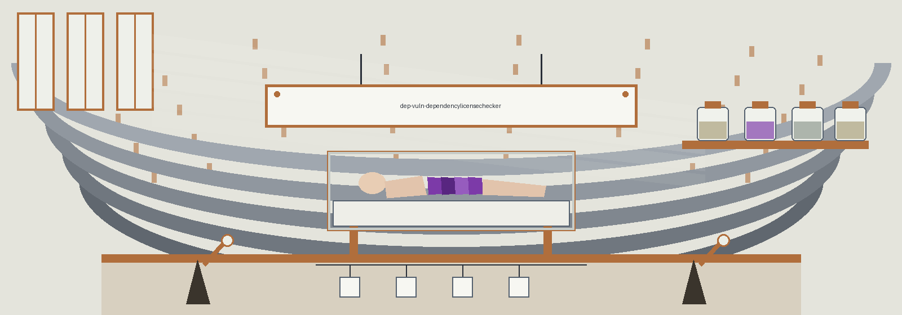

# dep-vuln-dependencylicensechecker

Title block: the name above is set in Bpmf Iansui in reagent violet on lab white, in the manner of a theatre notice board, with a copper rule beneath it and one small wax figure marker beside the first heading only.

# dep-vuln-DependencyLicenseChecker
A command-line tool that analyzes project dependencies and checks them for known vulnerabilities in the NVD or OSV databases. The --license_policy option is accepted but not evaluated: the code has no license data source, a warning is printed on every run, and the report covers vulnerabilities only. - Focused on Maps declared software dependencies in project manifest files (e.g., requirements.txt, package.json) to known vulnerabilities in public databases (e.g., NIST NVD, OSV). Generates a report detailing vulnerable dependencies and suggested remediation steps, such as updating to patched versions. Supports multiple dependency file formats and vulnerability data sources.

Note on versions: dependency entries are stored as requirement specifiers. Both checks need one concrete version, so only a pinned entry (a single == version, or a bare version in package.json) is queried; a range is skipped with a warning. The NVD check compares that concrete version to the version field of the CPE criteria in the response.

Note on empty manifests: if no dependencies are parsed or found to check (an empty requirements file, a file whose lines do not parse, or a package.json with no dependency keys), the run prints "No dependencies were parsed/found to check." and exits 1. It does not print the clean line. The clean line and exit 0 are reserved for runs that completed at least one check.

> Tied label: the licence policy is never evaluated. The option is accepted, stored, and warned about on every run, and the report covers vulnerabilities only.

> Tied label: only pinned versions are queried. Anything looser is skipped with a warning, and a skipped entry counts as neither a success nor a failure.

## Install
`git clone https://github.com/ShadowStrikeHQ/dep-vuln-dependencylicensechecker`

## Usage
`./dep-vuln-dependencylicensechecker [params]`

> Tied label: the NVD route reads one page only. A package whose records sit past the first page reads as clean on this route.

## Parameters
- `-h`: Show help message and exit
- `--license_policy`: No description provided
- `--vulnerability_db`: No description provided
- `--output`: No description provided

> Tied label: a report can print and the run can still exit 1. Entries parsed with no check completed still produce a report, and the run refuses to let a clean sounding page stand as a result.

## License
Copyright (c) ShadowStrikeHQ

## Tags left hanging

Install, Usage, Parameters, License: four short tags tied along the bench edge, each one handled, read, and left hanging where it was. The class has gone. The case is shut, the bench lamp stays lit over an empty well, and the figure rests exactly as it was found, having taught without moving.
